# PSoft Arena

Plataforma para submissao e avaliacao de solucoes de problemas de projeto de software
orientado a objetos. O professor cadastra problemas, estrategias de avaliacao, turmas e
modelos de LLM; os estudantes submetem solucoes em Java e acompanham o processamento e os
resultados. A avaliacao e automatica e nao executa o codigo submetido: usa analise estatica
e APIs externas de LLM.

## Status

Etapa 1 em andamento: scaffold Spring Boot (build, `shared/`, migration V1) em `projeto` e
US1-US5 nas branches proprias. Entrega e decisoes em [docs/etapas/etapa1.md](docs/etapas/etapa1.md).

## Modelo de dados (V1)

```mermaid
classDiagram
    class Professor {
        Long id
        String nome
        String email
    }
    class Problema {
        Long id
        String titulo
        String descricao
        String requisitosFuncionais
        String requisitosProjeto
        StatusProblema status
    }
    class Estudante {
        Long id
        String nome
        String matricula
        String email
    }
    class EstrategiaAvaliacao {
        Long id
        String nome
        TipoEstrategia tipo
        String descricao
        String prompt
    }
    class Turma {
        Long id
        String nome
        String codigo
        String periodoLetivo
        StatusTurma status
    }
    class TurmaEstudante {
        Long id
        Instant associadoEm
    }

    Professor "1" --> "0..*" Turma : responsavel
    Turma "1" --> "0..*" TurmaEstudante
    Estudante "1" --> "0..*" TurmaEstudante
```



Uniques: `estudante.matricula`, `professor.email`, `turma(codigo, periodo_letivo)` e
`turma_estudante(turma_id, estudante_id)`. `turma.professor_id` e as duas FKs de
`turma_estudante` usam `ON DELETE RESTRICT`.

## Quickstart

JDK 21; o wrapper Gradle ja vem no repositorio.

```bash
./gradlew test      # testes com H2 em memoria
./gradlew bootRun   # aplicacao em http://localhost:8080
```

Banco H2 em arquivo em `./data/arena`; OpenAPI/Swagger em `/v3/api-docs` e `/swagger-ui.html`.

## Estrutura

```text
br.edu.ufcg.psoft.arena
├── problema/  estudante/  estrategia/  turma/  professor/   # feature: entidade, repository, service, controller, DTO
└── shared/                                                   # BaseEntity, exceptions, OpenApiConfig, migration V1
```

## Contrato HTTP

Tudo sob `/api/v1`, com JSON em portugues conforme a especificacao:

- criacao responde `201` + `Location`; remocao e comando respondem `204` sem corpo;
- erros usam `ProblemDetail`: `400` validacao, `404` inexistente, `409` regra/duplicata/FK;
- `PATCH .../desativar` e `PATCH .../encerrar` sao comandos explicitos, nao campos do `PUT`.

Tabela completa em [docs/api/contrato-http.md](docs/api/contrato-http.md).

## US4 - Professor e turma

A US4 implementa o cadastro minimo de professor (criacao e consultas) e o cadastro,
consulta, edicao e encerramento de turmas, conforme o contrato HTTP. Professor deve
existir antes de cadastrar turma. Turmas nascem `ATIVA`; encerrar e uma transicao final,
com historico preservado. Associacoes de estudantes ficam na US5.

## Documentacao

- [CONTRIBUTING.md](CONTRIBUTING.md): branches, ordem de merge, revisores e checklist de PR.
- [docs/api/contrato-http.md](docs/api/contrato-http.md): contrato HTTP da etapa 1.
- [docs/etapas/etapa1.md](docs/etapas/etapa1.md): entrega, participacao e decisoes da etapa 1.
- [docs/adr/](docs/adr/): decisoes arquiteturais registradas.
- [especificacao_psoft_arena.pdf](especificacao_psoft_arena.pdf): especificacao da disciplina.
