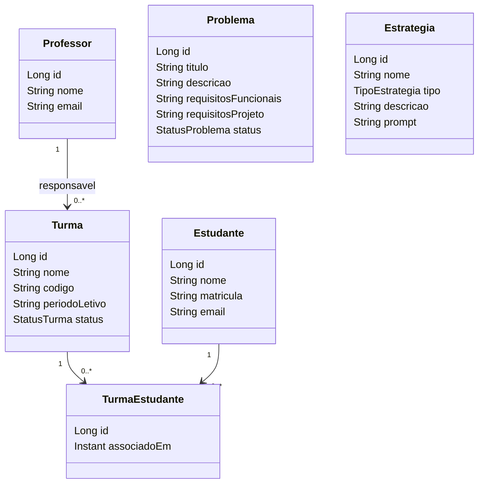

# Etapa 1 - PSoft Arena

Documento de entrega da primeira etapa: base da plataforma, US1-US5 e decisoes tomadas.

## Escopo da etapa

A etapa 1 entrega a base Spring Boot compartilhada e as cinco primeiras user stories, sem
autenticacao, sem LLM e sem interface grafica. O contrato HTTP fica fixado ja nesta etapa
para que as branches das USs nao divirjam.

| US | Tema | Responsavel | Revisor |
|---|---|---|---|
| US1 | Cadastro de problemas | Lucaslg7 | @RailtonDantas |
| US2 | Cadastro de estudantes | RailtonDantas | @matheusvir |
| US3 | Estrategias de avaliacao | jpereira-Dev | @Lucaslg7 |
| US4 | Turmas + professor minimo | ManoelNetto26 | @jpereira-Dev |
| US5 | Associacao estudante-turma | matheusvir | @ManoelNetto26 |

Participacao no scaffold: base Git/GitHub, build Gradle, `shared/`, migration V1 e smoke
tests preparados pelo dono do scaffold antes da abertura das branches de US.

## Ordem de merge

1. Scaffold commitado direto em `projeto` (excecao autorizada, sem PR).
2. US1, US2 e US3 em paralelo, cada uma por PR `us*` -> `projeto` com o revisor do ciclo.
3. US4 (professor minimo + turma) depois das tres primeiras, pois consome a FK de professor.
4. US5 por ultimo, pois depende de turma e estudante ja integrados.
5. Fechamento: PR `projeto` -> `main` (sem squash) + tag `etapa1`.

## Decisoes

- **Gradle Groovy + wrapper + Java 21 + Boot 3.5.6**: mesmo stack da disciplina.
- **H2 arquivo + Flyway + `ddl-auto: validate`**: zero infraestrutura na etapa 1; Postgres
  vira profile futuro. `open-in-view: false`.
- **Package-by-feature** (`problema/`, `estudante/`, `estrategia/`, `turma/`, `professor/`,
  `shared/`): evita concentrar tudo em pastas por camada.
- **`BaseEntity`** (`@MappedSuperclass`) com `id` e `equals`/`hashCode` por id; entidades
  usam `@Getter`, sem `@Data`.
- **Status sem setter**: transicoes via `desativar()`/`encerrar()`; `PUT` nao altera status.
- **TurmaEstudante explicita** com unique do par (turma, estudante) e `associado_em`.
- **Professor minimo dentro da US4**: nome e email unico, `POST` + `GET` lista/por id, sem
  `PUT`/`DELETE`; `turma.professor_id` usa `ON DELETE RESTRICT`.
- **`codigo` de turma unico por periodo**: `UNIQUE(codigo, periodo_letivo)`.
- **Requisitos do problema como TEXT livre**: `requisitos_funcionais` e
  `requisitos_projeto` copiados verbatim para o prompt da avaliacao futura.
- **V1 unica no scaffold**: evita conflito de migrations entre branches de US.
- **Rotas planas** (`/api/v1/problemas`, `/api/v1/turmas`): escopo por professor entra na
  etapa 3 junto com autenticacao.

## Modelo de dados (V1)

Restricoes relevantes: `estudante.matricula` unico, `professor.email` unico,
`turma(codigo, periodo_letivo)` unico, `turma_estudante(turma_id, estudante_id)` unico;
`turma.professor_id` e `turma_estudante.*` com `ON DELETE RESTRICT`/`CASCADE` conforme a V1.

## Contrato HTTP

Todos os endpoints ficam sob `/api/v1`, com JSON em portugues. Sucesso de criacao responde
`201` + `Location`; remocoes respondem `204`; erros usam `ProblemDetail` com `400`
(validacao), `404` (inexistente) e `409` (regra de negocio, duplicata ou FK). A tabela
completa esta no `README.md`.

## Pendencias

- Autenticacao e filtro `professorId` (etapa 3).
- Integracao com LLM (US6+) e snapshot de prompt/requisitos na avaliacao.
- Fechamento da etapa por PR `projeto` -> `main` e tag `etapa1`.
