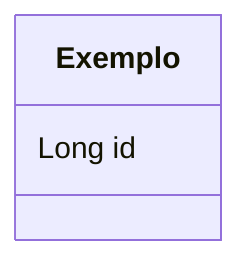

# Etapa N - PSoft Arena

Documento de entrega da etapa N: escopo, participacao, decisoes e pendencias.
Copie este arquivo para `docs/etapas/etapaN.md` e preencha.

## Escopo da etapa

O que entra e o que fica de fora (auth, LLM, interface grafica, etc.). Uma ou duas frases
sobre o objetivo da etapa.

## Participacao

| US | Tema | Responsavel | Revisor | PR |
|---|---|---|---|---|
| USx | ... | @... | @... | #... |

Participacao no scaffold / apoio fora das USs: quem fez o que.

## Decisoes

- **Decisao**: motivo e alternativa descartada.
- Decisoes que mudam o modelo de dados ou o contrato devem virar ADR em `docs/adr/`.

## Modelo de dados (VX)

Diagrama congelado da etapa (copiado do estado real do schema no fechamento):

Restricoes relevantes: uniques e `ON DELETE RESTRICT`.

## Contrato HTTP

Convencoes da etapa e link para o contrato: [../api/contrato-http.md](../api/contrato-http.md).

## Pendencias

- Item que ficou para a proxima etapa, com etapa alvo.

## Fechamento

- PR `projeto` -> `main` (sem squash) mergeado e tag `etapaN` criada no commit final.
