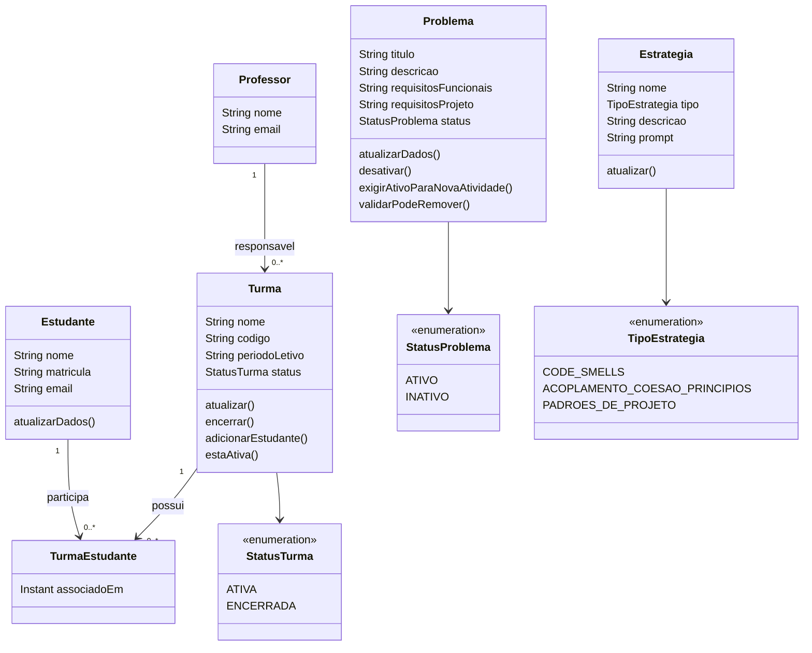

# Modelagem — etapa 1 (US1 a US5)

Snapshot congelado em 03/11/2026. Não editar: correções só factuais, com nota de data.
Diagrama vivo da etapa corrente fica no README.

Problema nasce `ATIVO` e passa a `INATIVO` so por `desativar()`; turma nasce `ATIVA`
e passa a `ENCERRADA` so por `encerrar()`; estudante-turma exige turma ativa e sem duplicata.
